<div align="center">

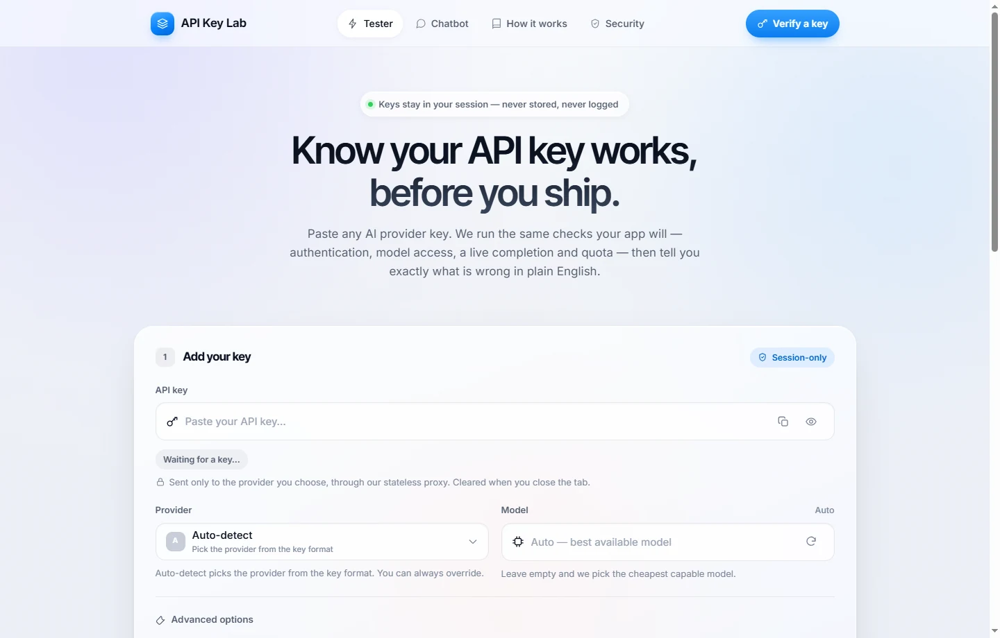

# API Key Lab

**Know your API key works, before you ship.**

Paste any AI provider key. Get a real health report — authentication, model access, a live completion, latency, tokens and quota — in plain English. Then chat with the same key on a dedicated page.

[](https://apikeylab.vercel.app)
[](LICENSE)
[](#quick-start)
[](#-supported-providers)

[](https://github.com/muhammadsami987123/api-key-lab/stargazers)
[](https://github.com/muhammadsami987123/api-key-lab/pulls)
[](https://x.com/MSAMIWASEEM1)

[**🚀 Demo**](#-demo) · [**📸 Screenshots**](#-screenshots) · [**⚡ Quick start**](#-quick-start-30-seconds) · [**🔌 API**](#-api-reference) · [**🔐 Security**](#-security-model)

</div>

---

## 📑 Table of contents

- [Demo](#-demo)
- [Screenshots](#-screenshots)
- [Why this exists](#-why-this-exists)
- [What it checks](#-what-it-checks)
- [Features](#-features)
- [Supported providers](#-supported-providers)
- [Quick start (30 seconds)](#-quick-start-30-seconds)
- [Project structure](#-project-structure)
- [Architecture](#-architecture)
- [API reference](#-api-reference)
- [Security model](#-security-model)
- [Error handling](#-error-handling)
- [Design system](#-design-system)
- [Troubleshooting](#-troubleshooting)
- [Roadmap](#-roadmap)
- [Contributing](#-contributing)
- [Credits](#-credits)

---

## 🚀 Demo

> **Live:** <https://apikeylab.vercel.app>

No sign-up, no install, no tracking. Open the page, paste a key, read the report.

```bash
git clone https://github.com/muhammadsami987123/api-key-lab.git
cd api-key-lab
npm start          # → http://localhost:3000
```

That is the entire setup: **zero dependencies**, no build step, no Vercel CLI, no environment variables.

<table>
<tr>
<td width="50%">
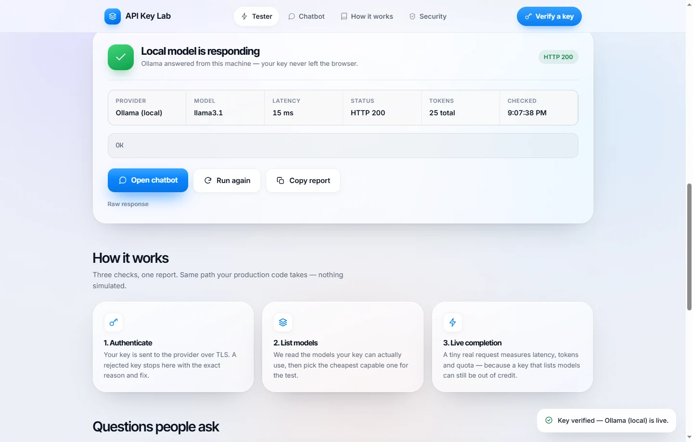
<p align="center"><sub><b>Healthy key</b> — auth, model, latency, tokens, quota</sub></p>
</td>
<td width="50%">
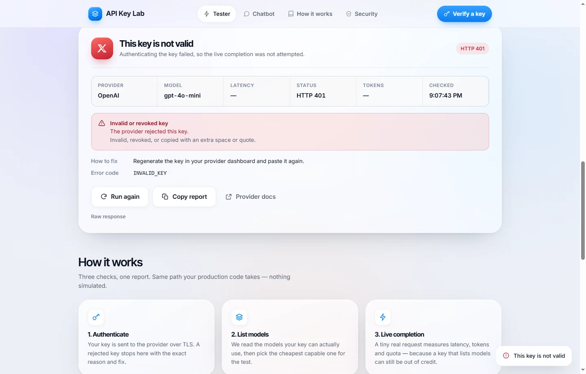
<p align="center"><sub><b>Dead key</b> — the real reason, the error code, and the fix</sub></p>
</td>
</tr>
</table>

---

## 📸 Screenshots

### Paste a key — the provider is detected for you

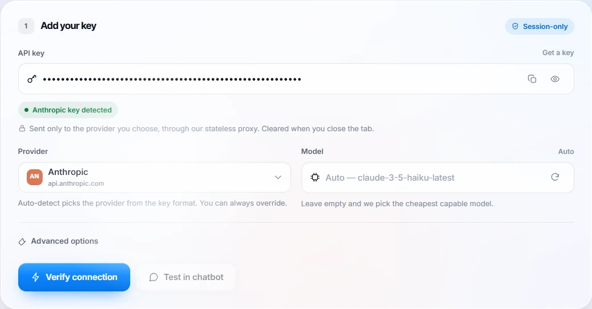

<sub>Paste an Anthropic key and the provider, the API host and the model are filled in. No dropdown hunting.</sub>

### Pick a provider — searchable glass popover, not a native select

<table>
<tr>
<td width="62%">
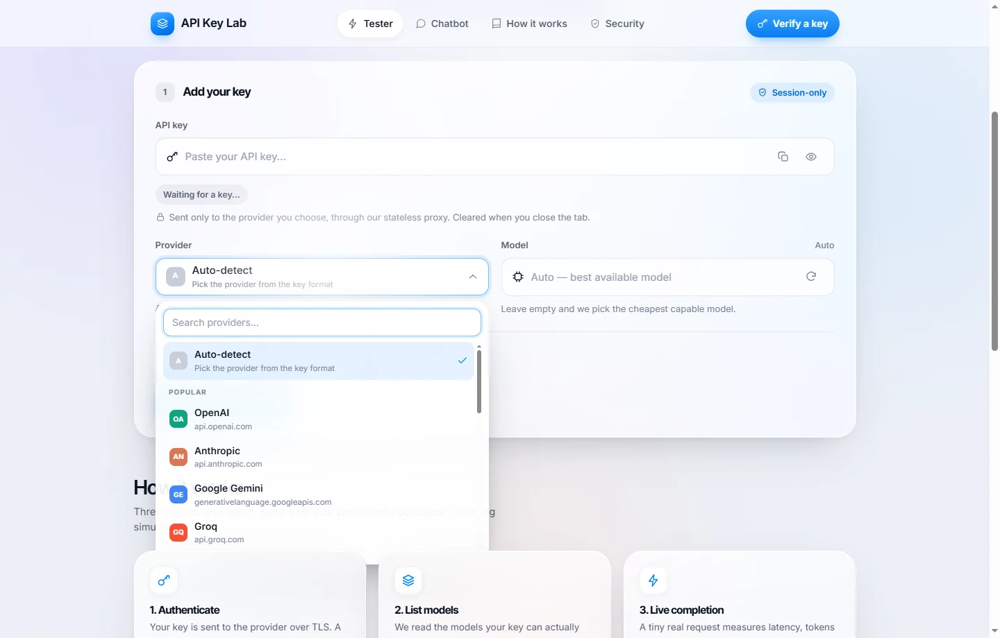
</td>
<td width="38%">
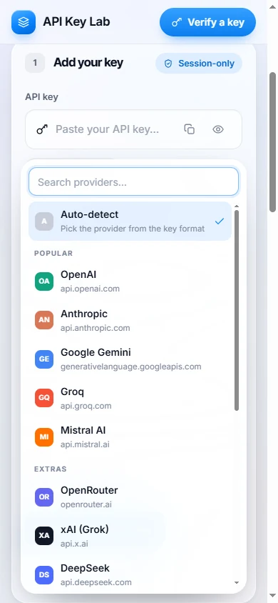
</td>
</tr>
</table>

<sub>16 providers, grouped and searchable, with `↑ ↓ Enter Esc` keyboard support. On phones it becomes a bottom sheet.</sub>

### Watch the checks run — every step is visible

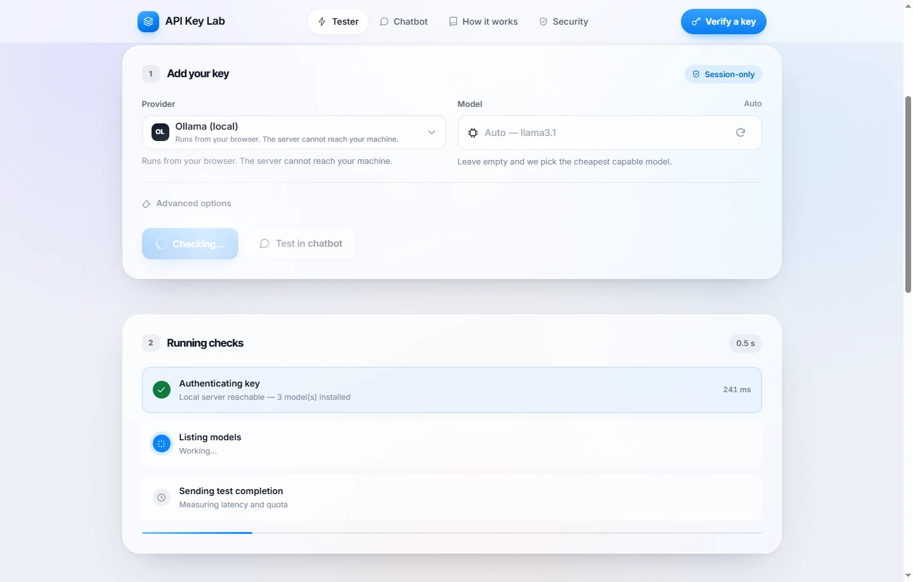

<sub>Authentication → model list → live completion, each with its own timing. Nothing is simulated: the third step is a real request.</sub>

### The chatbot — same key, streaming answers

<table>
<tr>
<td width="50%">
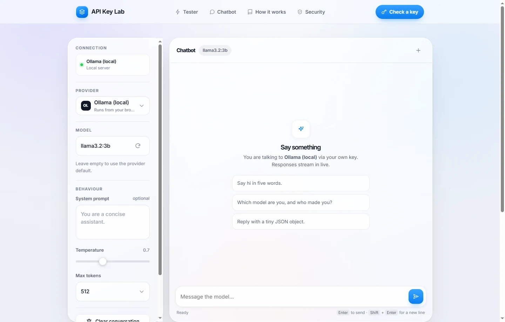
</td>
<td width="50%">
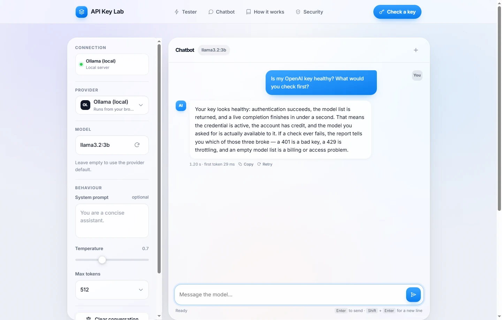
</td>
</tr>
</table>

<sub>Temperature, max tokens, system prompt, stop generation, retry, copy. The key carries over from the tester through `sessionStorage` — and is wiped on reload.</sub>

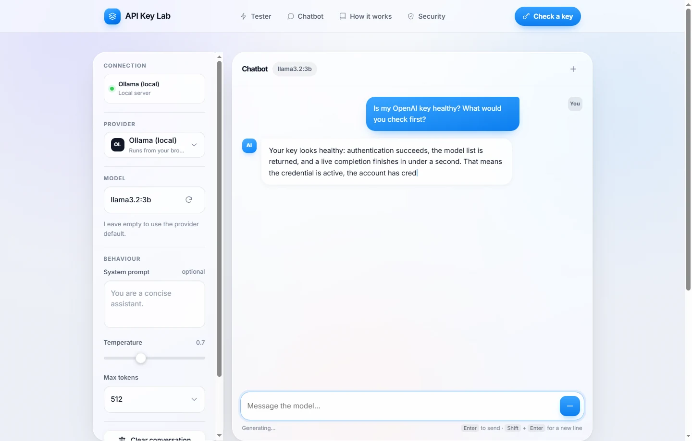

<sub>Responses stream token by token over SSE, with a live first-token timer and a stop button.</sub>

### Details that matter

<table>
<tr>
<td width="60%">
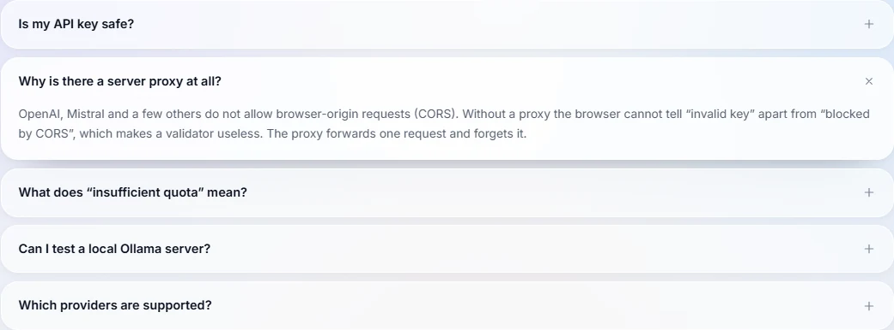
<p align="center"><sub><b>FAQ</b> — one panel at a time, height-animated both ways</sub></p>
</td>
<td width="40%">
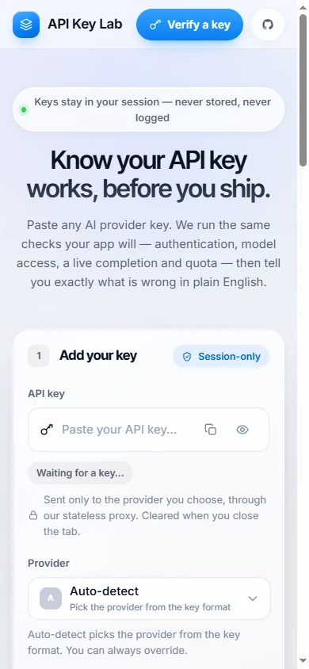
<p align="center"><sub><b>Mobile</b> — 44 px targets, 360 px and up</sub></p>
</td>
</tr>
</table>

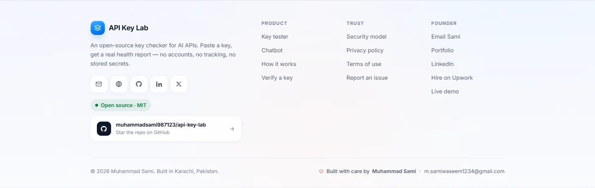

---

## 🤔 Why this exists

A key can fail in six different ways, and every provider reports it differently:

| What you see | What it usually means | What people assume |
|---|---|---|
| `401` | Key is revoked, mistyped, or from another project | "The provider is down" |
| `402` / `insufficient_quota` | Key is fine, the account has **no credit** | "My key expired" |
| `403` with a region line | Account or model blocked in your country | "Bad key" |
| `404` on the model | Model renamed or not enabled for this key | "API is broken" |
| `429` | Rate limit or daily quota exhausted | "Wrong key" |
| CORS error in the browser | Provider blocks browser origins at all | "Invalid key" |

**API Key Lab separates all of them** — it is the difference between *"your key is dead"* and *"your key is alive, you just have no money on the account."*

---

## ✅ What it checks

| Step | Check | What it proves |
|---|---|---|
| 1 | **Authenticate** | The key is accepted by the provider |
| 2 | **List models** | Which models this key can actually use — then picks the cheapest capable one |
| 3 | **Live completion** | A real (tiny) generation request — catches no-credit, quota, rate limit, model-access and billing problems |

A key that "lists models" can still be out of credit. That is why step 3 exists.

---

## ✨ Features

| | Feature | Why it matters |
|---|---|---|
| 🔍 | **Key auto-detection** | Recognises Anthropic, OpenAI, Gemini, Groq, OpenRouter, xAI, Perplexity and AWS keys from their prefix. Ambiguous keys are flagged, never guessed |
| 🧠 | **Smart model choice** | Fetches the model list, suggests the cheapest capable model, and auto-retries a second model on `404` |
| 🧾 | **Honest errors** | Every failure is mapped to a reason, a fix, the provider's own message and a copyable error code |
| 💬 | **Dedicated chatbot** | Separate page, streaming SSE, model switcher, temperature, max tokens, system prompt, retry, stop |
| 🔐 | **Session-only keys** | `sessionStorage` only, wiped on tab close **and on every reload**. No accounts, cookies, analytics or database |
| 🪟 | **Glass UI** | iOS "Settings" aesthetic — frosted surfaces, drifting mesh, 300 ms spring motion, reduced-motion aware |
| ♿ | **Accessible** | Keyboard-first picker, ARIA live regions, visible focus rings, 360 px → desktop responsive |
| 📦 | **Zero runtime dependencies** | Plain HTML/CSS/JS + Node's `http` module. No framework, no build step, no `node_modules` |
| ☁️ | **Deploy anywhere Node runs** | Vercel one-liner, but the same `server.js` works on a VPS, Railway, Fly or your laptop |

---

## 🔌 Supported providers

<details>
<summary><b>16 providers — click to expand</b></summary>

<br />

| Group | Provider | Auth used |
|---|---|---|
| Popular | OpenAI | `Authorization: Bearer` |
| Popular | Anthropic | `x-api-key` + `anthropic-version` |
| Popular | Google Gemini | `?key=` query |
| Popular | Groq | Bearer (OpenAI-compatible) |
| Popular | Mistral AI | Bearer (OpenAI-compatible) |
| Extras | OpenRouter | Bearer |
| Extras | xAI (Grok) | Bearer |
| Extras | DeepSeek | Bearer |
| Extras | Together AI | Bearer |
| Extras | Perplexity | Bearer (no model list) |
| Local | Ollama | none — **browser → localhost directly** |
| Local | Custom OpenAI-compatible | Bearer + your Base URL |
| Enterprise | Azure OpenAI | `api-key` + resource/deployment/api-version |
| Enterprise | AWS Bedrock | SigV4 (access key + secret + region) |
| Enterprise | Google Vertex AI | Service-account JSON → JWT → OAuth |

</details>

### Fields per provider

| Provider | Fields you need |
|---|---|
| OpenAI, Groq, Mistral, OpenRouter, xAI, DeepSeek, Together, Perplexity, Anthropic, Gemini | API key only |
| Ollama | Base URL (default `http://localhost:11434`) — no key |
| Custom | API key + HTTPS Base URL |
| Azure OpenAI | API key + resource URL + deployment name + API version |
| AWS Bedrock | Access key ID + secret access key + region + model id |
| Vertex AI | Service-account JSON + location (project taken from the JSON) |

### Local Ollama

Local calls bypass the proxy entirely — the browser talks to your machine.

```bash
OLLAMA_ORIGINS=* ollama serve              # macOS / Linux
$env:OLLAMA_ORIGINS="*"; ollama serve      # Windows PowerShell
```

---

## ⚡ Quick start (30 seconds)

**Requirements:** Node 18+ (nothing else).

```bash
git clone https://github.com/muhammadsami987123/api-key-lab.git
cd api-key-lab
npm start
```

Open **<http://localhost:3000>**.

`server.js` serves the site from `frontend/` and mounts the exact handlers Vercel runs (`backend/handlers/*`) behind `/api/*` — so no `vercel dev`, no CLI install, no login.

| Page | URL |
|---|---|
| Tester | <http://localhost:3000/> |
| Chatbot | <http://localhost:3000/chat> |
| Terms | <http://localhost:3000/terms> |
| Privacy | <http://localhost:3000/privacy> |
| Security | <http://localhost:3000/security> |

Port busy? `PORT=8080 npm start` (PowerShell: `$env:PORT=8080; npm start`).

<details>
<summary><b>No Node at all?</b></summary>

<br />

Double-click `frontend/index.html`. The UI, key detection and the **Ollama** / **Custom** providers work (they talk to the provider directly from the browser). Proxied providers need `/api/*`, so they require `npm start`.

</details>

<details>
<summary><b>Deploy to Vercel</b></summary>

<br />

```bash
npm i -g vercel
vercel login
vercel --prod
```

Or import the repo in the dashboard — framework **Other**, no build command, no environment variables. `vercel.json` sets `outputDirectory: "frontend"`, a strict CSP, HSTS, `no-store` on `/api/*` and `maxDuration: 60` for streaming.

> Do not add `"dev": "vercel dev"` to `package.json` — the CLI re-invokes itself and fails with *"must not recursively invoke itself"*.

</details>

---

## 🗂 Project structure

```
api-key-lab/
├─ frontend/                    # everything the browser loads
│  ├─ index.html                # Tester: key → health report, FAQ
│  ├─ chat.html                 # Dedicated chatbot page
│  ├─ terms.html / privacy.html / security.html
│  └─ assets/
│     ├─ css/glass.css          # Design tokens, glass system, motion
│     └─ js/
│        ├─ common.js           # Icons, toasts, session store, nav
│        ├─ providers.js        # Provider registry + key detection
│        ├─ picker.js           # Glass provider picker (listbox)
│        ├─ accordion.js        # Animated single-open FAQ
│        ├─ app.js              # Tester logic + report rendering
│        └─ chat.js             # Chat logic + SSE streaming
├─ backend/                     # all server-side code
│  ├─ handlers/{verify,chat}.js # Plain Node (req, res) handlers
│  └─ lib/
│     ├─ providers.js           # Adapters, error taxonomy, SigV4, Vertex JWT
│     └─ guard.js               # Origin check, body cap, rate limit
├─ api/{verify,chat}.js         # Vercel entry points (2-line re-exports)
├─ docs/screenshots/            # Images used in this README
├─ archive/index.legacy.html    # Original 2024 single-file build
├─ server.js                    # Local server — plain Node, no dependencies
├─ vercel.json
└─ package.json
```

**Why `api/` still exists:** Vercel only auto-routes functions inside a root `api/` directory. Those two files are two-line re-exports, so the real code stays in `backend/` and the same handlers run locally and in production.

---

## 🧭 Architecture

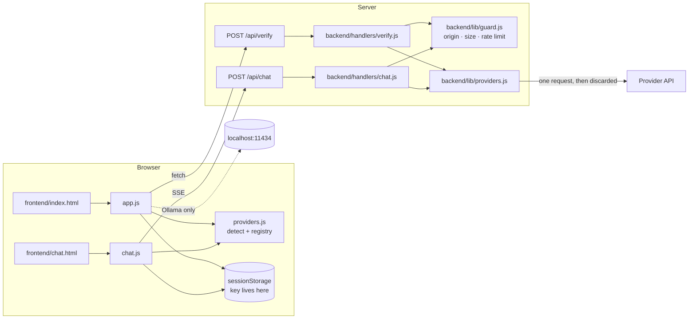

- **Stateless:** the proxy forwards the key once and forgets it. No database, no logs, no cache.
- **Same code everywhere:** `api/*.js` are re-exports, so local and production behaviour cannot drift.

---

## 🔗 API reference

<details>
<summary><b>POST /api/verify</b></summary>

<br />

```json
{
  "action": "verify",
  "config": {
    "provider": "openai",
    "apiKey": "sk-...",
    "model": "",
    "baseUrl": "",
    "region": "us-east-1",
    "deployment": "",
    "apiVersion": "",
    "location": "us-central1",
    "serviceAccount": ""
  }
}
```

`action` may be `verify` (default) or `models`.

```json
{
  "ok": true,
  "status": "valid",
  "title": "Key is valid and generating",
  "providerName": "OpenAI",
  "model": "gpt-4o-mini",
  "httpStatus": 200,
  "latencyMs": 812,
  "usage": { "prompt": 9, "completion": 2, "total": 11 },
  "quota": { "remainingRequests": "499", "remainingTokens": "149990", "reset": "6s" },
  "stages": [
    { "id": "auth", "label": "Authenticating key", "status": "ok", "ms": 320 },
    { "id": "models", "label": "Listing models", "status": "ok", "ms": 0 },
    { "id": "completion", "label": "Sending test completion", "status": "ok", "ms": 812 }
  ],
  "suggestedModel": "gpt-4o-mini",
  "preview": "OK",
  "error": null
}
```

`status` is `valid`, `warning` (works but throttled), `invalid` or `error`.

</details>

<details>
<summary><b>POST /api/chat</b></summary>

<br />

```json
{
  "config": { "provider": "anthropic", "apiKey": "sk-ant-...", "model": "" },
  "messages": [{ "role": "user", "content": "Hello" }],
  "stream": true,
  "maxTokens": 512,
  "temperature": 0.7
}
```

Normalised SSE stream:

```
data: {"delta":"Hel"}
data: {"delta":"lo"}
data: {"done":true,"model":"claude-3-5-haiku-latest"}
```

Errors arrive as `data: {"error":{...}}`. With `stream: false` you get JSON instead.

**Limits:** 40 messages, 8 000 chars each, 16–2 048 output tokens, 20 s provider timeout, 256 KB body cap, 40 checks/min and 60 chats/min per IP.

</details>

---

## 🔐 Security model

| Concern | How it is handled |
|---|---|
| Key storage | `sessionStorage` only — gone when the tab closes or the page reloads. Never in a cookie, never on disk |
| Server retention | The proxy forwards the key once and discards it. No database, no logs, no cache |
| Abuse | Same-origin check, 256 KB body cap, per-IP rate limits, 20 s upstream timeout |
| SSRF | Custom base URLs must be HTTPS and cannot resolve to private or loopback hosts |
| XSS | Strict CSP (`script-src 'self'`), no inline scripts, no third-party scripts, `nosniff`, `DENY` framing |
| Privacy | No accounts, no analytics, no tracking pixels, no fonts beyond Google Fonts |

Full detail: [`frontend/security.html`](frontend/security.html) · [`frontend/privacy.html`](frontend/privacy.html)

> Use scoped or low-limit keys while testing. Never paste a key you are not allowed to transmit to a third-party web app.

---

## 🧯 Error handling

| Situation | What the report shows |
|---|---|
| `401` | Invalid or revoked key — regenerate it |
| `400` + "API key not valid" | Invalid key for that API |
| `402` / `insufficient_quota` | Key valid, account has no credit |
| `403` (region) | Model or account blocked in your country |
| `403` (model/scope) | Key lacks access to that model |
| `404` (model) | Model renamed — auto-retries another model |
| `429` | Rate limit / quota exhausted, with reset hint |
| `5xx` | Provider incident — retry later |
| Timeout (20 s) | Provider unreachable from the proxy |
| Local network error | Ollama not running, or `OLLAMA_ORIGINS` missing |

---

## 🎨 Design system

Light-only "iOS Settings glass":

- frosted surfaces (`blur(28px) saturate(180%)`), specular top line, matte inner glow
- drifting mesh background with a subtle grain overlay
- iOS palette — blue `#0A84FF`, green `#0F7B3F`, amber `#9A5B00`, red `#C21F30`
- Inter / Inter Tight, 28 px card radius, 18 px controls, 44 px touch targets
- motion 180–300 ms `cubic-bezier(.22,1,.36,1)`, spring press feedback, staggered reveals
- respects `prefers-reduced-motion` and `prefers-contrast`, keyboard focus, ARIA live regions

---

## 🩺 Troubleshooting

| Problem | Fix |
|---|---|
| `Port 3000 is already in use` | `PORT=8080 npm start` |
| Verify says "Missing configuration" | The page was opened via `file://` — run `npm start` |
| "Cross-origin requests are not allowed" | Use the site's own URL, not a proxy or iframe wrapper |
| Chat streams nothing | Network tab: the response must be `text/event-stream` |
| Custom provider rejects the URL | Base URLs must be `https://`; use Ollama for local HTTP |
| Bedrock "signature" error | Check region and clock skew; the secret must match the access key |
| Vertex "service account" error | Enable the Vertex AI API, grant `Vertex AI User` |
| `vercel dev` says "must not recursively invoke itself" | Remove any `"dev": "vercel dev"` script |
| FAQ snaps instead of animating | `prefers-reduced-motion` is on — intentional |

---

## 🗺 Roadmap

- [ ] Save a report as PNG / PDF
- [ ] Compare two keys side by side
- [ ] Batch check a `.env` file (client-side only)
- [ ] Key expiry and last-used hints where providers expose them
- [ ] Dark theme (opt-in, respects the glass system)
- [ ] More providers: Fireworks, Replicate, Anyscale, vLLM

Have a better idea? [Open an issue](https://github.com/muhammadsami987123/api-key-lab/issues).

---

## 🤝 Contributing

Contributions are welcome — especially new provider adapters.

1. Fork and clone.
2. `npm start` — no install step, no build.
3. Add the provider to `backend/lib/providers.js` and `frontend/assets/js/providers.js`.
4. Open a PR with a screenshot of a real report.

Good first issues are labelled [`good first issue`](https://github.com/muhammadsami987123/api-key-lab/labels/good%20first%20issue).

---

## ⭐ Star this repo

If this saved you an hour of debugging, a star helps other developers find it.

[](https://star-history.com/#muhammadsami987123/api-key-lab&Date)

---

## 👤 Credits

**Made by Muhammad Sami** — design, frontend, and the serverless proxy.

- Portfolio: <https://muhammad-sami.vercel.app>
- GitHub: [@muhammadsami987123](https://github.com/muhammadsami987123)
- LinkedIn: [in/muhammad-sami](https://www.linkedin.com/in/muhammad-sami-3aa6102b8/)
- X: [@MSAMIWASEEM1](https://x.com/MSAMIWASEEM1)
- Email: <m.samiwaseem1234@gmail.com>

Licensed under the [MIT License](LICENSE) · © 2024–2026 Muhammad Sami

<div align="center">

**If it helped, [⭐ star the repo](https://github.com/muhammadsami987123/api-key-lab) — and tell one person whose key just died.**

</div>
